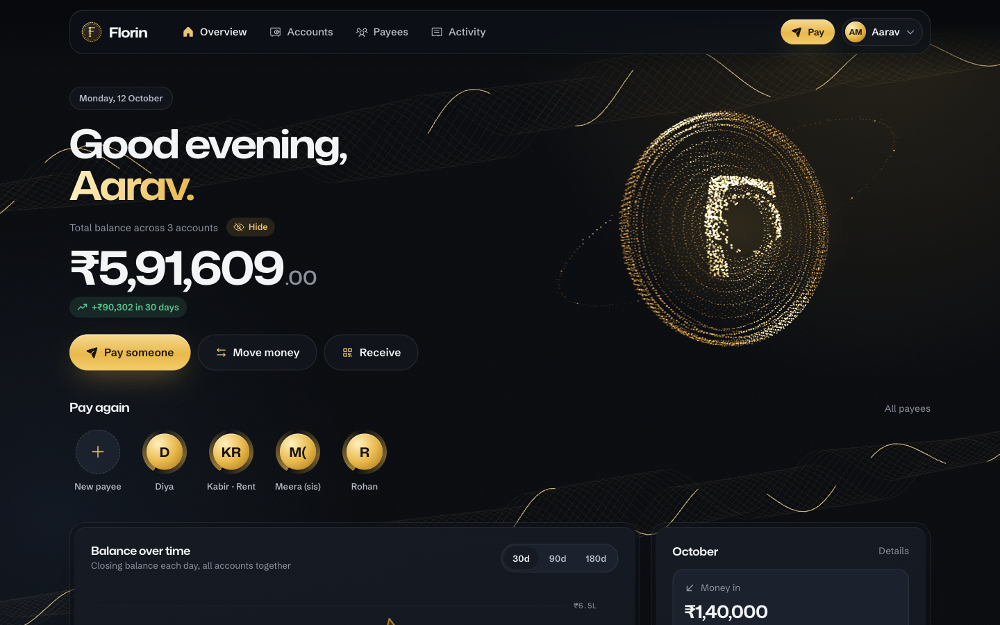
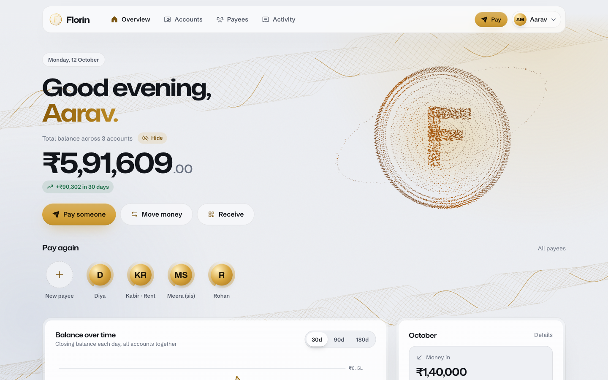
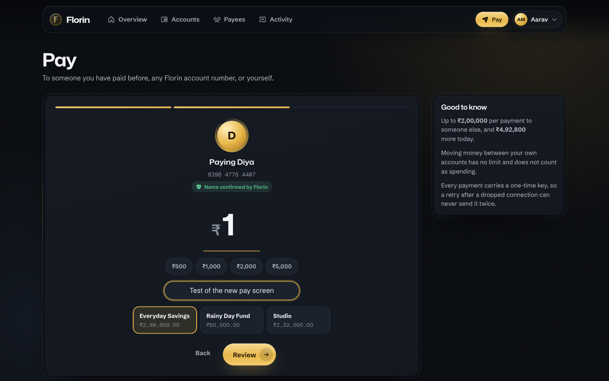
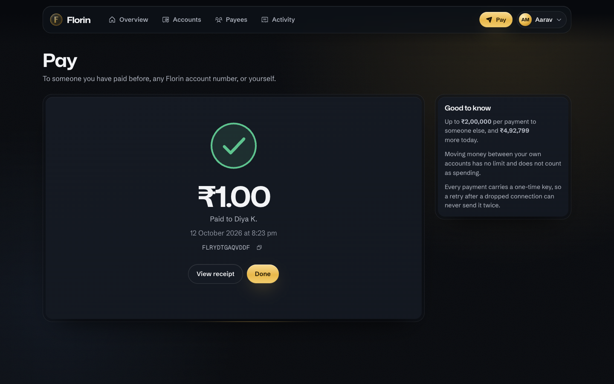
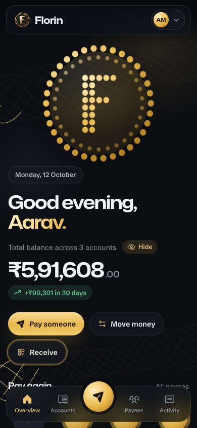

# Florin

A small retail bank you can run on a laptop: accounts, deposits and withdrawals, transfers between
customers, saved payees, statements and a dashboard, built end to end as a portfolio project.
The backend is a Spring Boot ledger with real money rules (limits, idempotent payments, row locks,
database constraints). The frontend is a React app in gold on deep ink: the Florin coin is a WebGL cloud
of gold dots that assembles on load and scatters from the cursor, the pay flow borrows the best of UPI
apps (a people row, a big centred amount, a success burst, a QR code to get paid), and every screen
sits on a slow atmosphere of aurora light and banknote-style guilloché lines.





<p>
  
  
</p>
<p>
  
  
</p>

## What it does

- **Sign up and sign in** with bearer-token sessions (SHA-256 of the token in the database, a short
  Redis cache in front), a list of signed-in devices with remote sign-out, and password change that
  signs out every other device.
- **Accounts**: every customer starts with a savings account; open up to five (savings or current),
  rename, freeze (money can come in, not go out), close (only when empty), balance inquiry.
- **Money movement**: cash deposits and withdrawals, and transfers to any Florin account by its
  12-digit Luhn-checked number. Each movement is a transaction with ledger entries (a debit and a
  credit for transfers), so every balance equals the sum of its ledger and each statement line carries
  a running balance.
- **Rules**: ₹2,00,000 per payment to others, ₹5,00,000 outgoing per bank day (Asia/Kolkata), no
  limits between your own accounts, no overdrafts. `Idempotency-Key` on every money POST, so a retried
  request can never pay twice.
- **Payees**: look up an account number and see the holder's masked name ("Asha R.") before saving.
- **Statements and activity**: filter by account, direction, date range and text; download a CSV with
  spreadsheet formulas defused.
- **Dashboard**: total balance (hide it with one tap, as UPI apps do), 30/90/180-day balance history,
  money in and out this month versus last, a "Pay again" row of people, a grid of money moves, the
  daily-limit meter, account cards and recent activity.
- **Receive money**: a QR code (drawn in dots) that opens Florin's pay screen with your account filled
  in; the payer still sees your confirmed name before paying.
- **Demo data**: `FLORIN_DEMO_SEED=true` creates `demo@example.com` / `florin-demo` with four months of
  believable history, posted through the same ledger code as live traffic.

## Stack

| Layer | Choice |
|---|---|
| Backend | Java 21, Spring Boot 4.1, Spring Data JPA (Hibernate 7), Spring Security, Flyway, MySQL 8.4, Redis 7.4 |
| Tests | JUnit 5, MockMvc, Testcontainers (real MySQL and Redis), Mockito; Postman collection run with newman |
| Frontend | React 19, TypeScript, Vite 8, React Router 8, TanStack Query 5, Motion 14, React Three Fiber (custom point shaders), Phosphor icons, qrcode-generator |
| Design | Mona Sans (wide display) + Schibsted Grotesk + Geist Mono, all self-hosted; one gold accent on deep ink; light and dark themes |
| Ops | Docker Compose, nginx (single public entry, CSP, rate limit), GitHub Actions |

## Run it

Prerequisites: Docker, Java 21, Node 24.

```bash
# 1. Databases
docker compose up -d --wait

# 2. API on :8080, with the demo customer
cd backend && FLORIN_DEMO_SEED=true ./mvnw spring-boot:run

# 3. Web app on :5173 (proxies /api to the backend)
cd frontend && npm install && npm run dev
```

Open http://localhost:5173 and use **Fill in** on the sign-in page (demo@example.com / florin-demo).

Everything in containers, behind nginx on port 80:

```bash
cp .env.example .env          # set MYSQL_ROOT_PASSWORD and MYSQL_PASSWORD
docker compose -f compose.prod.yaml up -d --build
```

The stack is sized for a handful of people: one API instance (`BACKEND_REPLICAS` raises it), a
128 MB Redis that only holds caches and counters, and MySQL on a named volume.

## How the backend is put together

Packages are features, not layers (`auth`, `customer`, `account`, `transaction`, `statement`,
`payee`, `insights`), each with its entity, repository, service, controller and request/response
records side by side. Cross-cutting pieces live in `config` (security, CORS, problem-JSON errors,
housekeeping) and `ratelimit`.

- **The ledger** (`transaction/Ledger.java`) is the only code that changes a balance. Each method is
  one database transaction that locks the paying customer's row, then the accounts in ascending id
  order (so opposing transfers cannot deadlock), checks every rule against the locked rows, and posts
  a transaction with its ledger entries. `READ COMMITTED` isolation keeps the daily-limit sum honest
  once the customer lock is held.
- **Idempotency** (`transaction/TransactionService.java`): the key and a hash of the request are stored
  with the transaction; a repeat returns the original receipt with `Idempotent-Replayed: true`, a reuse
  with different details is refused, and a race between two identical requests is settled by the unique
  index. Deadlocks are retried up to three times.
- **The schema is the last line of defence**: `CHECK (balance >= 0)`, positive amounts, closed accounts
  must be empty, one account per number, one ledger line per account per transaction. The tests prove
  each constraint by writing bad rows directly with JDBC.
- **Errors** are RFC 9457 problem JSON everywhere, including the 401 from the security filter and the
  429 from the rate limiter, with a stable `code` and, for validation, a `fields` map.
- **Redis is optional at runtime**: the session cache and the rate limiter both degrade to the
  database and to in-memory buckets when it is unreachable.

## API

All routes are under `/api`; everything except `POST /customers/register`, `POST /auth/login` and
`GET /config` needs `Authorization: Bearer <token>`.

| Area | Routes |
|---|---|
| Auth | `POST /auth/login`, `DELETE /auth/logout`, `GET /auth/sessions`, `DELETE /auth/sessions/{id}`, `POST /auth/password` |
| Customers | `POST /customers/register`, `GET /customers/me`, `PATCH /customers/me` |
| Accounts | `GET /accounts`, `POST /accounts`, `GET /accounts/{id}`, `GET /accounts/{id}/balance`, `PATCH /accounts/{id}`, `POST /accounts/{id}/freeze`, `/unfreeze`, `/close` |
| Money | `POST /accounts/{id}/deposits`, `POST /accounts/{id}/withdrawals`, `POST /transfers`, `GET /transactions/{reference}`, `GET /limits` |
| Statements | `GET /activity`, `GET /accounts/{id}/transactions`, `GET /accounts/{id}/statement?from&to` (CSV) |
| Payees | `GET /payees`, `POST /payees/lookup`, `POST /payees`, `PATCH /payees/{id}`, `DELETE /payees/{id}` |
| Insights | `GET /insights?days=30` |

`postman/florin.postman_collection.json` walks the whole API (23 requests with assertions):
`npx newman run postman/florin.postman_collection.json`.

## Tests

`cd backend && ./mvnw verify` runs 309 tests against throwaway MySQL 8.4 and Redis 7.4 containers:
API tests per feature, unit tests for the auth service, account numbers and money formatting, database
constraint tests, error-shape tests on a real Tomcat, rate-limit tests with Redis up and down, and
concurrency tests (60 opposing transfers at once, 25 simultaneous withdrawals against a ₹1,000 balance,
a ten-way retry storm with one idempotency key). Skip them with `-DskipTests` when you only want a jar.

`cd frontend && npm run build` typechecks and builds the web app.

## Frontend notes

- `src/lib` holds the API client (problem-JSON aware, idempotency keys, file downloads), auth and theme
  providers, query hooks and Indian-format money and date helpers.
- The balance chart is hand-drawn SVG: one series, an area wash under a 2px line, a crosshair that snaps
  to the nearest day, keyboard navigation and a table twin for screen readers.
- The dotted coin (`components/DottedCoin.tsx`) is about 5,700 points in one custom shader: the dots fly in
  from a scattered cloud and settle into the coin (field, raised F, rims, reeded edge), a band of light
  sweeps the face, dots twinkle, the cursor pushes them aside, and a new balance makes the coin pulse.
  The CPU only updates a few uniforms per frame. It loads lazily and only on desktop with a fine pointer,
  WebGL 2 and no reduced-motion preference; everyone else gets the same coin as a dotted SVG mark.
- The atmosphere (`components/Backdrop.tsx`) is CSS and SVG: two slow aurora fields, film grain, and
  guilloché ribbons (interlaced sine strands, as on banknotes) with a glint travelling along them.
- Motion comes from Motion 14: word-by-word headline reveals, cards that tilt toward the pointer with a
  glare and a border that lights where the pointer is, magnetic buttons with a sheen, step transitions in
  the pay flow and a success burst of gold dots. All of it stops for reduced-motion users.
- The UPI-style touches are built on the real API: payees become the "Pay again" row, the QR code encodes a
  pay link with the account number, and the success screen shows the transaction's own reference.
- The colour tokens were checked for WCAG AA text contrast, and the chart series colour for each theme
  passed the dataviz validator's lightness and contrast gates.

## Repository layout

```
backend/    Spring Boot API (src/main/java/com/florin/bank/<feature>), Flyway migrations, tests
frontend/   Vite + React app (src/pages, src/components, src/lib, src/styles), nginx.conf
postman/    API collection
docs/       Screenshots and docs/BUGS-AND-FIXES.md, the log of everything that went wrong on the way
compose.yaml / compose.prod.yaml
```
